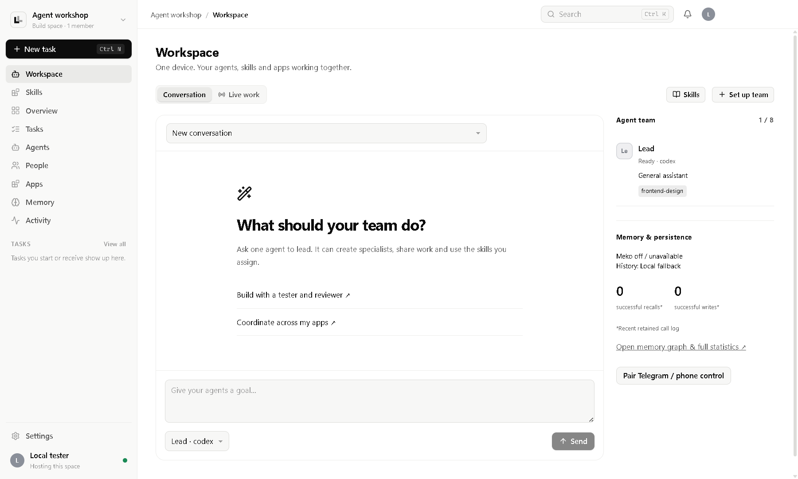
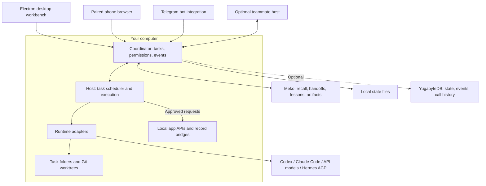
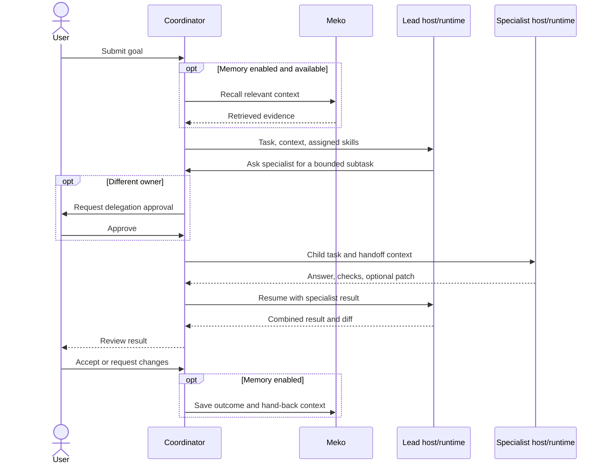
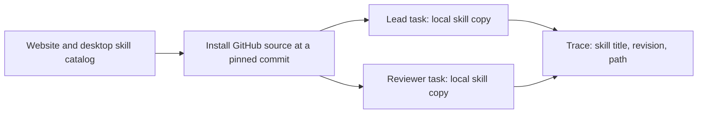

<p align="center">
  
</p>
<h1 align="center">Larp</h1>
<p align="center"><strong>One workspace. A team of agents. Context that carries forward.</strong></p>
<p align="center">
  <a href="https://larp-seven.vercel.app">Website & downloads</a> ·
  <a href="#quick-start">Quick start</a> ·
  <a href="#architecture">Architecture</a> ·
  <a href="#how-meko-changes-the-work">Meko</a> ·
  <a href="#five-minute-demo">Demo</a>
</p>

Larp is a desktop workspace for coordinating AI agents on your own computer. Give a lead agent a goal, let it ask specialists for help, and inspect their conversations, skills, changes, checks, and approvals in one place. Meko carries useful context between tasks and agents; optional YugabyteDB persistence records workspace state and activity.

Start with one laptop. Invite teammates into a shared space when needed, or control work from a paired phone or Telegram while the host stays online.



*Workspace screenshot from a local test profile. Memory is intentionally off in this capture; the counters are not staged usage.*

> **Release scope:** This README describes the current integration branch. Model accounts, Meko, Telegram, and GitHub require their respective setup. A public website demo is not a remotely running desktop agent.

## Why Larp

A second agent is useful only when it receives the right context, works on a clear subtask, and returns something the lead can use. Larp makes that exchange explicit: task ownership, independent workspaces, structured handoffs, shared skills, persistent lessons, and reviewable results.

For a small development team, this means a reviewer can pass a repository-specific constraint to an implementer instead of making the user repeat it. For everyday workflows, agents can coordinate records in connected apps through explicit, approved requests.

| Capability | What happens in Larp |
|---|---|
| Agent teams | Create a lead and specialists; up to eight agents per owner in a space, with up to three tasks running concurrently per host. |
| Agent-to-agent work | A lead asks another agent a question or delegates a bounded subtask. Answers and compatible repository patches return to the lead. |
| Repository work | Tasks with a Git repository use separate worktrees. Review changes and checks before accepting onto a separate branch. |
| Shared skills | Desktop and website use the same catalog. Installed skills are pinned to a Git commit and copied into each task workspace. |
| Persistent context | Recall before work, record outcomes, pass handoff notes, and promote approved lessons through Meko. |
| App actions | Agents request a particular app route when needed. Both reads and writes wait for owner approval. |
| Remote control | Paired phone UI and Telegram provide task control, follow-ups, traces, and approvals. |
| Personal workspace | Themes, backgrounds, Ocean mode, and optional Piixpal companions customize the workbench. |

## Quick start

**Prerequisites:** Node.js 22, npm, Git, and a graphical desktop. Windows is the primary tested platform. Choose an installed Codex CLI with your own sign-in, or configure the API runtime in Larp. GitHub operations additionally require authenticated `gh`.

Five commands to run this integration version from source:

```sh
git clone --branch integration/local-workspace-fixes https://github.com/diiviikk5/Larp.git
cd Larp
npm ci
npm run build
npm start
```

In the app:

1. Create a space and open **Set up team**.
2. Choose Codex or connect an OpenAI API key. Larp uses the official Codex CLI sign-in; it does not embed a separate subscription login protocol.
3. Attach a local Git repository for coding tasks. Without one, agents receive a task output folder rather than your project files.
4. Create a lead, install and assign skills, then give it a bounded task.
5. Inspect **Live work** and the full task trace. Review results before accepting them.

Example prompt:

> Inspect this repository's checkout flow. Ask a reviewer to identify compatibility constraints, implement one focused fix, and run the relevant tests. Return the diff and explain which recalled decisions influenced the change.

### Install on Windows

Use the installer from the [download page](https://larp-seven.vercel.app/#download). The setup wizard allows you to **choose the installation directory**, including another drive. Installation is per user; there is no hardcoded developer drive or account path.

Settings and workspace data live separately under Electron's standard Windows user-data location, normally `%APPDATA%/larp/larp`. Choosing another installation drive does not relocate that data. Agent repositories are selected independently in the app.

### Optional services

Copy `.env.example` to `.env` in the repository and fill only the services you want:

| Variable | Purpose |
|---|---|
| `MEKO_API_KEY` | Connect directly to your Meko account. |
| `LARP_TEAM` | Unique prefix for product datapacks, such as `your-team-larp`. |
| `YUGABYTE_URL` | Optional YSQL connection string for workspace state, events, and Meko call history. |
| `YUGABYTE_CA` | Path to your database CA certificate when required. |
| `LARP_CODEX` | Optional path to the Codex CLI you want Larp to run. |
| `LARP_CLOUD=off` | Disable the optional Larp Cloud gateway. Directly configured services can still be used. |

Packaged builds can use the configured Larp Cloud gateway for memory and persistence; source runs can use direct credentials. Cloud persistence does **not** execute desktop tasks while a laptop is off. Check the workspace's actual connection status before a demo.

Never commit a populated `.env`. API keys entered through desktop setup are encrypted using Electron `safeStorage`. Model access and billing remain with the selected provider/account.

## Architecture



| Layer | Responsibility | Source |
|---|---|---|
| Workbench | Conversation, task trace, agent setup, skills, memory, appearance | [src/](src/) |
| Desktop shell | Local services, credential storage, app embedding, installation and updates | [electron/](electron/) |
| Coordinator | Shared state, membership, task transitions, approvals, events | [server/coordinator.mjs](server/coordinator.mjs) |
| Host | Workspace preparation, runtime execution, delegation, app requests | [server/host.mjs](server/host.mjs) |
| Runtime adapters | Translate a task into the selected CLI or API tool loop | [server/adapters/](server/adapters/) |
| Memory orchestration | Recall, outcomes, lessons, handoffs, maintenance, proof storage | [server/memory.mjs](server/memory.mjs) |
| Meko client | MCP calls, connection handling, call logging | [server/meko.mjs](server/meko.mjs) |
| Persistence | Local state and optional YSQL storage | [server/store.mjs](server/store.mjs), [server/db.mjs](server/db.mjs) |

The coordinator manages work; the host executes it. Multiple hosts can connect to a space, but a single machine can run a complete team. Agents have persisted configuration and task history; their model processes are invoked for work rather than kept continuously thinking.

### Agent collaboration



CLI agents communicate through task-local protocol files, including `.larp/ask-Name.md`, `.larp/spawn.json`, and `.larp/app-request.json`. API agents have corresponding tools such as `ask_agent`, `spawn_agent`, and `app_request`.

The host interprets these requests and resumes the task with results. Nested delegation is bounded; only lead tasks may spawn specialists. Follow-ups are consumed at turn boundaries, and stopping a parent cancels its active children. See [the agent protocol](docs/local-workspace.md).

### Skills: shared source, independent working copies



Agents can use the same skill revision without editing each other's working files. Up to eight skills can be assigned to an agent. Catalog installation commands are references; Larp does not blindly execute them. Supporting programs, accounts, and dependencies may still need setup. A skill-load receipt proves its instructions were supplied, not that every recommended action succeeded.

## How Meko changes the work

Meko supplies continuity across tasks and agents. The useful unit is a remembered decision that changes what an agent does: a compatibility constraint, a previously rejected approach, or a tested fix another agent can reuse.

**Current product layout:** `<LARP_TEAM>-team` holds team memory and shared lessons. Agent and space keys provide attribution and application-level organization. Optional `<LARP_TEAM>-skills` and `<LARP_TEAM>-apps` datapacks hold searchable reference documents. The project's build datapack is separate from product data.

**Isolation boundary:** an `agent_id` is not an authorization boundary. Do not treat agents within one shared datapack as private tenants. Separate security domains need separate datapacks and appropriate access controls.

| Meko use | Why it exists | Implementation |
|---|---|---|
| Recall before reasoning | Carry relevant prior work into a new task | `context_search` / memory retrieval before execution |
| Conversation storage and extracted memories | Preserve useful outcomes beyond a model context window | `conversation_add_message` and explicit `memory_add` paths |
| Agent handoffs | Give a specialist the context behind the request and return learning to the lead | Handoff and hand-back notes in the product datapack |
| Promotion to shared knowledge | Make a reviewed lesson reusable by other agents | Human approval followed by `memory_promote` |
| Searchable documents | Find relevant skill guidance and app contracts | `knowledgebase_search` over configured libraries |
| Proof artifacts | Retain result diffs and recognize identical content | `artifact_put` / `artifact_get` |
| Maintenance | Review duplicates and stale notes; suggest lessons | Memory review, update, and delete operations |

The Memory page and task trace expose recall/write activity, sources, and available memory controls. Usage figures reflect recorded calls; reported token savings are Meko estimates, not measured dollar savings. If Meko fails, the task can continue with context marked unavailable. With memory switched off, that task gets no Meko recall.

YugabyteDB has a different role: it persists structured workspace state and event/call history. It does not replace Meko's semantic retrieval or run model inference.

**Current fidelity limit:** the recall display can substitute a locally approved lesson's wording for a matching retrieved passage. Exact returned text and the human-approved wording still need separate presentation before claiming strict, verbatim context provenance. Memory correction/forget coverage also needs a complete UI audit. See [memory design](docs/memory.md) and [Check T](docs/check-t.md).

## Connected apps

App access is **on demand**. An ordinary coding task does not preload Swasthya, Kosh, or other private records. The agent names an app and route; the owner approves before a read or write occurs. Successful calls return a task-specific receipt.

| App | Domain | Integration |
|---|---|---|
| Swasthya | Family health organization | Bundled local service and authenticated API |
| Kosh | Family finance organization | Bundled local service and authenticated API |
| Citylines | Transport planning and records | Embedded UI with revisioned record bridge |
| EduSpace | Learning and study records | Embedded UI with revisioned record bridge |
| Studio | Creative workspace records | Embedded UI with revisioned record bridge |

Open embedded record apps once to initialize synchronization. These integrations manage records; they do not initiate bank transfers, book transport, or provide autonomous medical care. Public [Swasthya](https://larp-swasthya-demo.vercel.app) and [Kosh](https://larp-kosh-demo.vercel.app) demos use fictional, browser-local data.

Task prompts, answers, handoffs, and result artifacts can contain information derived from an app. When memory is enabled, those contents may be sent to Meko. Local app storage alone does not guarantee that sensitive information never leaves the device. Use fictional data for shared demos.

## Teammates, phones, and Telegram

**Two downloaded desktop copies can join the same space.** On the host, enable network access and create an invite. On the second computer, choose **Join another space** and paste the full invite. Both machines need a reachable network path; `127.0.0.1` always means the current computer, not your teammate's laptop.

Each host uses its own configured runtime and sign-in. Installing Larp does not share the developer's Codex account, credentials, repositories, or personal data.

- **Phone:** pair through Settings → Phones and open the responsive web client. Use the same network or a suitably configured private VPN.
- **Telegram:** connect a bot through Settings → Telegram, then pair your chat. Plain text starts a task; `@Name` selects an agent. Reply to its acknowledgement to continue, or use `/chat TASK_ID message`, `/trace TASK_ID`, and `/stop TASK_ID`.
- **Voice:** system-wide dictation tools such as Wispr Flow can type into the focused prompt. This is ordinary desktop dictation, not an embedded Wispr API integration.

The host must remain running and awake. Telegram long-polls outward; the paired browser needs direct reachability. LAN HTTP is intended for trusted networks; use an appropriate secured connection for remote access.

## Five-minute demo

**Persona:** a small team's release owner. **Problem:** implementation agents repeatedly miss a compatibility decision that another teammate already made.

Use a disposable repository with a legacy client and a contract test. Record a genuine decision such as “keep the old response field until the legacy client migrates,” with its author and rationale, and promote it through Meko.

| Time | Show |
|---|---|
| 0:00–0:45 | The repository, the legacy contract, two agents, and the approved decision in Meko. |
| 0:45–1:45 | Memory off: submit a bounded endpoint change. Show the actual diff and test outcome. |
| 1:45–3:15 | Reset to the same commit and repeat the same prompt/model with memory on. Show returned context, the reviewer handoff, and resulting changes. |
| 3:15–4:15 | Inspect checks, accept the result, and show the stored outcome or shared lesson. |
| 4:15–5:00 | From a paired phone, request a follow-up or inspect the trace. Show successful Meko calls and persistence status. |

The expected hypothesis is that recalled compatibility context changes the implementation. A live model may solve both runs correctly; report what actually happened. The deterministic memory suite checks the mechanism, while a recorded live comparison must substantiate the demo claim.

### hackCBS 9.0 evidence map

| Requirement | Evidence to show | Remaining work |
|---|---|---|
| A1: context changes outcomes | Identical task with Meko off/on, diffs and checks | Capture a controlled live comparison |
| A2: three real Meko uses | Recall, handoff, promotion, documents, artifacts | Show successful calls and explain each use |
| A3: persona and story | Release owner preserving a legacy contract | Prepare the demo fixture |
| A4: visible context | Task recall and Memory activity | Audit correction/forget and exact source rendering |
| A5: honest and private | Fictional data, actual responses and receipts | Resolve provenance limitations before claiming full compliance |
| Check T: shared build context | Ten promoted decisions from two teammates' coding agents; live cross-teammate recall | Verify actual contributions; multiple agents for one person do not satisfy this |
| Meko feature proposal | [Proposal document](docs/meko-feature-proposal.md) | Present concrete friction and expected impact |

## Development and verification

```sh
npm run build
node test/workspace.mjs
node test/task-arrival.mjs
node test/execution-permissions.mjs
npm run test:talk
npm run test:memory
```

These cover orchestration, delayed task-state rendering, approval gates, agent handoffs, and memory behavior. Several use deterministic runtime/Meko stand-ins; they are not evidence of a paid provider or live Telegram round-trip.

Additional checks:

```sh
npm run meko:check                 # live Meko credentials required
node test/workspace-live.mjs       # real Codex account and upstream skill
npm run test:join                  # two desktop instances
npm run dist:win                  # Windows installer
npm run test:packaged              # packaged executable smoke check
```

A real Codex lead/reviewer exchange has been exercised locally. Real Telegram delivery, paid API execution, GitHub push/PR operations, and cross-network joining must be verified with the relevant accounts/network. No blanket provider compatibility or production-hardening claim is implied.

The Codex adapter defaults to `workspace-write`. Optional full-access execution requires owner approval before each turn. This is filesystem/command access; Larp does not currently provide screenshot, mouse, or keyboard automation. Other adapters retain their own restrictions.

### Repository map

```text
electron/       Desktop lifecycle, IPC, credentials, app services
src/            React + TypeScript workbench
server/         Coordinator, hosts, runtimes, memory, persistence
apps/           Bundled Swasthya and Kosh services and interfaces
public/         App assets, embedded apps, companions
site/           Public website and shared skills catalog
web-demos/      Browser-local app demo builds
test/           Integration, UI, runtime, and packaged-app checks
docs/           Setup, protocols, demo, and Meko documentation
tui/            Optional terminal client
```

Built with Electron, React, TypeScript, Vite, Node.js, the MCP SDK, Meko, and optional YugabyteDB YSQL. Packaging targets exist for Windows, macOS, and Linux; Windows has the primary validation coverage.

## Further reading

- [Local workspace and agent protocol](docs/local-workspace.md)
- [Setup and joining a space](docs/getting-started.md)
- [Meko memory design](docs/memory.md)
- [App API contracts](docs/apps-api.md)
- [Shared build context / Check T](docs/check-t.md)
- [Meko feature proposal](docs/meko-feature-proposal.md)

Bundled third-party assets retain their notices and licenses, including the MIT-licensed Piixpal companions.
